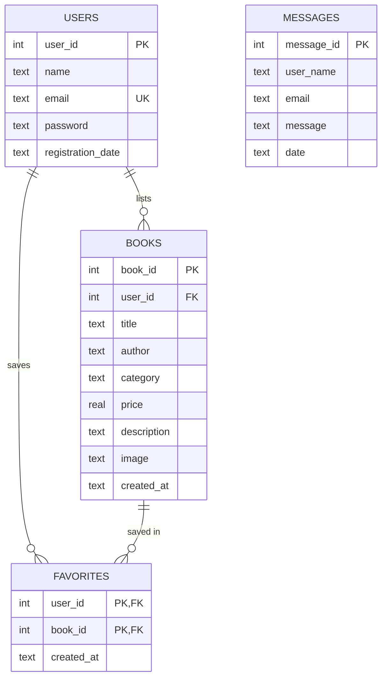

# 📚 BookNest — Online Book Store & Library

Full-stack web project: **HTML5 + CSS3 + JavaScript** (frontend) · **Python Flask** (backend) · **SQLite** (database).

## Project structure
```
BookNest/
│
├── frontend/
│   ├── index.html  about.html  contact.html  login.html  register.html
│   ├── books.html  book_detail.html  categories.html  faq.html
│   ├── dashboard.html  profile.html  wishlist.html  book_form.html
│   ├── base.html  _macros.html  error.html      (shared layout / components)
│   ├── css/style.css
│   ├── js/script.js
│   └── images/            (library-hero.jpg, logo.svg, about.svg, contact.svg, uploads/ = sample book covers)
│
├── backend/
│   ├── app.py             application entry point (creates the Flask app)
│   ├── config.py  db.py  security.py  validators.py
│   ├── routes/            URL → function   (main, auth, book, user routes)
│   ├── controllers/       business logic + database queries
│   ├── tests/test_app.py  automated tests
│   └── requirements.txt
│
├── database/
│   └── database.sql       table definitions (booknest.db is created from it on first run)
│
└── README.md
```
The `.html` files in `frontend/` are Jinja templates: Flask fills in the data from the database
and sends finished HTML to the browser.

## Run it (VS Code terminal, from the project root)
```bash
python -m venv venv
venv\Scripts\activate            # Windows  (macOS/Linux: source venv/bin/activate)
pip install -r backend/requirements.txt
python backend/app.py            # open http://127.0.0.1:5000
```
First start creates `database/booknest.db` from `database/database.sql` and adds a demo
account — **demo@booknest.com / Demo@1234** — with 4 sample books (real covers + authors).

Tests: `python -m unittest discover backend/tests -v`

## Assignment checklist
**Frontend:** Home, About, Books (products), Contact, Register/Login · navigation menu, header & footer ·
images (library hero photo, SVG illustrations, logo, real book covers) · forms with suitable input types
(text, email, password, number, search, file, select, textarea) · JavaScript validation ·
responsive (Flexbox + Grid, mobile menu) · semantic HTML (`header nav main section article aside figure footer`) ·
no inline CSS · plus dark/black theme toggle.

**Backend:** registration (validated + stored) · login with hashed passwords and sessions ·
database connection · CRUD on books (Create, Read, Update, Delete) · server-side validation ·
contact/feedback saved to the database.

**Database:** `users`, `books` (products), `messages`, `favorites` (wishlist).

| Table | Columns |
|---|---|
| users | user_id, name, email, password (hashed), registration_date |
| books | book_id, user_id (FK), title, author, category, price, description, image, created_at |
| messages | message_id, user_name, email, message, date |
| favorites | user_id (FK), book_id (FK), created_at |

## ER diagram


## Request flow (for your presentation)
Register form → JavaScript validation → `POST /register` → `routes/auth_routes.py` →
`controllers/auth_controller.py` validates again, hashes the password → row saved in SQLite →
redirect to login with a success message.

## Security notes
Hashed passwords · CSRF tokens on every POST · parameterised SQL (no string-built queries) ·
Jinja auto-escaping · session reset on login · only a book's owner can edit/delete it ·
upload type/size limits with random file names · `/assets` serves only css, js and images
(templates are never exposed). Before real deployment set a strong `SECRET_KEY`, use HTTPS and turn debug off.
